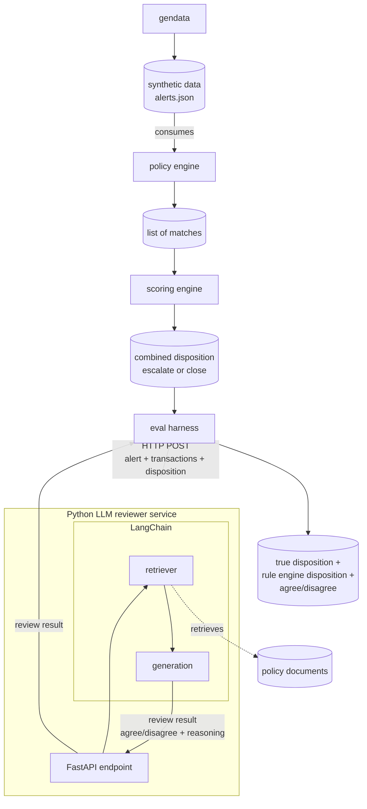

# Architecture

This document describes the end-to-end pipeline for `aml-triage`: a rule-based
alert scorer combined with an LLM reviewer stage that checks the rule engine's
decisions against transactions and policy documents.

## Overview

The original hand-drawn version of this diagram is kept at
[`docs/architecture-diagram.png`](docs/architecture-diagram.png).

## Stages

### 1. Synthetic data generation (`cmd/gendata`, `internal/gendata`)

Generates `data/alerts.json`: a set of synthetic alerts, each with a customer,
a list of transactions, and a **hidden ground truth** (`TrueDisposition`,
`TruePolicyRef`). This is a test fixture, not a model of real-world alert
generation — it exists to give the scorer and the LLM reviewer something to
be graded against later.

### 2. Policy engine (`internal/policy`)

Each alert's transactions are checked against every registered `Rule` (e.g.
`StructuringRule`: 3+ transactions each at or under £10,000 within a rolling
72-hour window, per `POL-STRUCT-01`). `PolicyEngine.Assess` collects every
rule that fires into a list of `Match`es (rule name, reasoning, policy
reference). It does not read `TrueDisposition`.

### 3. Scoring engine (`internal/scoring`)

`ScoreEngine.Score` takes the list of matches and combines them into a single
`Disposition`: `escalate` (with combined reasoning and policy refs) or
`close` (no matches). This is the ground-truth decision maker for stage one,
and it's plain Go — no AI involved.

### 4. Eval harness (`cmd/evalharness`, not yet built)

The only stage allowed to read `TrueDisposition`. For each alert, it calls
the Python LLM reviewer service over HTTP, then compares both the rule
engine's disposition and the LLM's review verdict against the hidden ground
truth, producing precision/recall for each.

### 5. Python LLM reviewer service (not yet built)

A FastAPI service, called by the eval harness via `POST /review` with the
alert, its transactions, and the rule engine's disposition as JSON.

Internally it uses **LangChain**:
- A **retriever** pulls the relevant chunks from `data/policies/*.md`
  (embedded into a vector store, e.g. pgvector) — this is the RAG step.
- A **generation** step feeds the retrieved policy text, the transactions,
  and the rule engine's disposition into an LLM, which produces a
  **review result**: agree or disagree with the rule engine's call, plus its
  own reasoning and the policy evidence it used.

Every LangChain call is traced with **Langfuse** for observability.

Note: the LLM reviewer does **not** re-decide escalate/close from scratch —
it's a second opinion on the rule engine's existing decision, grounded in the
actual policy text rather than a hardcoded threshold.

## Design decisions

- **Go for the core pipeline** (data gen, policy engine, scoring engine, eval
  harness), **Python + LangChain** for the LLM reviewer service, called over
  HTTP — keeps the deterministic pipeline in Go (the author's strength) while
  getting hands-on LangChain/Langfuse experience for the AI engineering
  pieces.
- **LLM as reviewer, not replacement decision-maker.** Matches how real AML
  systems work: by the time an LLM would plausibly get involved, the alert
  and its rule-based disposition already exist. The LLM's job is to check
  that decision against the real transactions and policy text, not to
  re-derive it blind.
- **PolicyEngine collects all matches, not first-match-wins**, so a single
  alert can breach multiple rules and the scoring engine sees all of them.
- **No database in the Go pipeline.** The policy engine, scoring engine, and
  eval harness pass the `Alert` (including its transactions) and
  `Disposition` forward entirely in memory / over HTTP. The only database in
  the design is the policy-document vector store used by the Python
  service's retriever.
